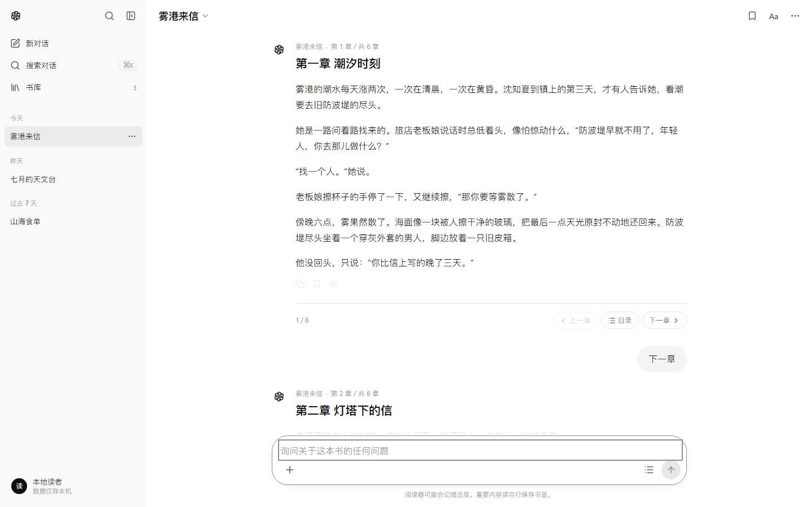
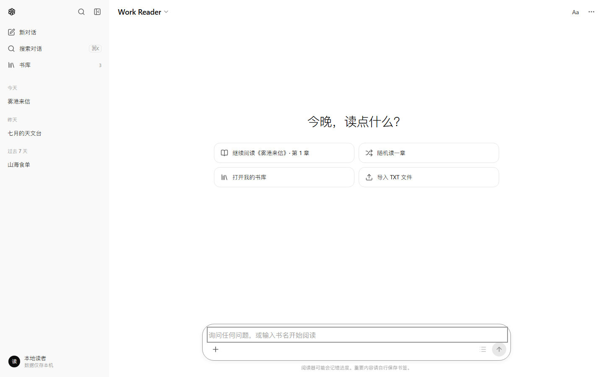
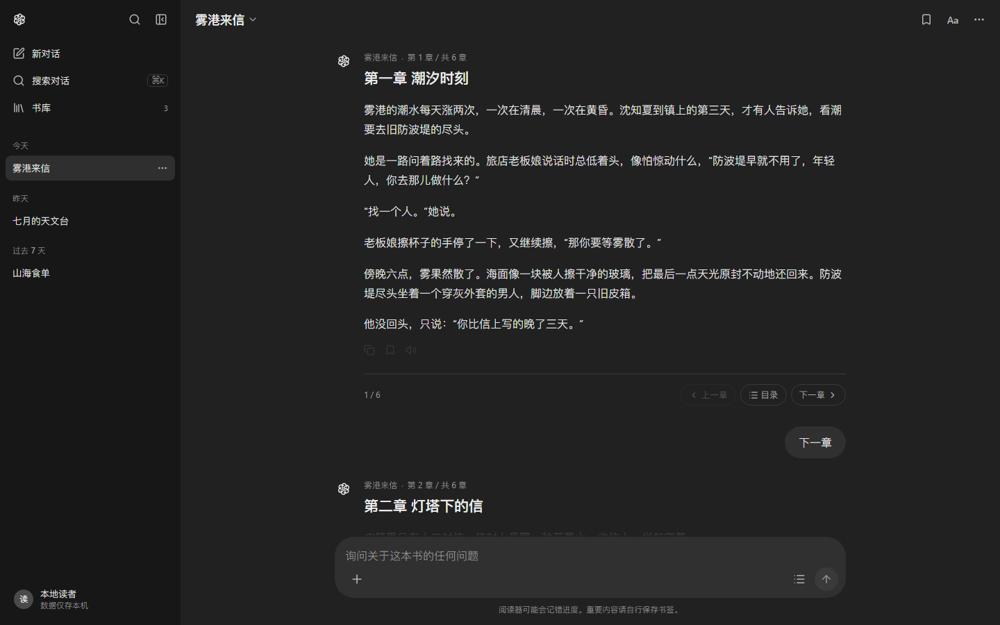
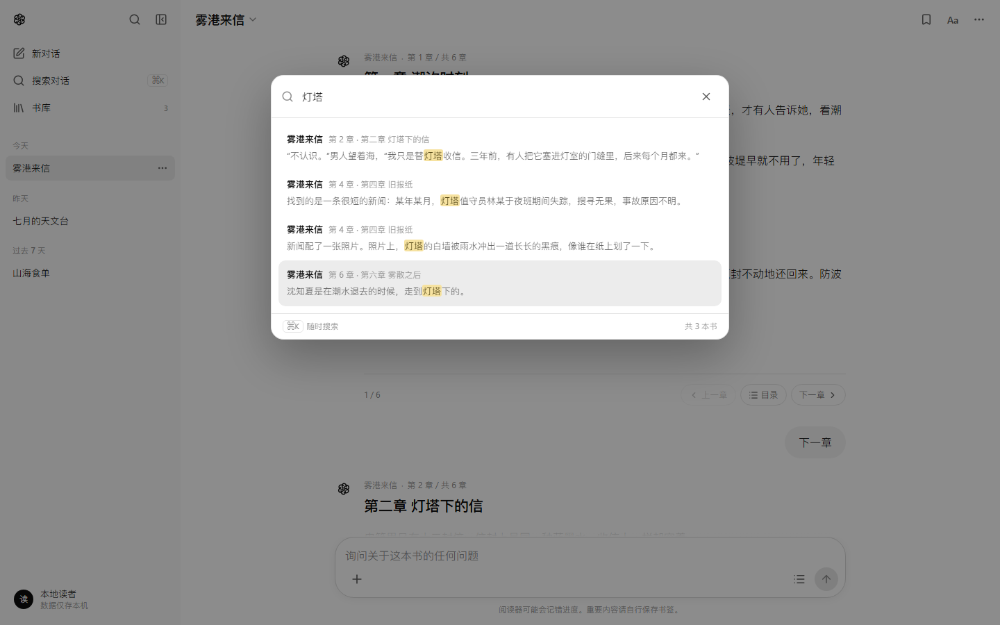

<div align="center">

# Work Reader

**一个长得像 ChatGPT 的本地小说阅读器**

左侧是会话式书库，右侧以 ChatGPT 消息流逐章展开正文。  
输入框既是阅读指令，也是全文搜索框。所有数据留在浏览器里，没有账号，也没有服务端。

</div>



## 预览

| 浅色 · 首页 | 深色 · 阅读 | 全文搜索 |
| :---: | :---: | :---: |
|  |  |  |

截图来自本地实际运行页面。

## 功能

**阅读**

- 章节以助手消息的形态流式展开，用户指令以气泡出现在右侧。
- 打开书后自动回到上次读到的章节；“继续阅读”“随机读一章”都在首页。
- 章节底部直接翻页，也可以输入 `目录`、`第 5 章`、`下一章`。
- 书签、章节进度、复制本章、浏览器朗读（SpeechSynthesis）。

**书库**

- 拖拽 TXT 到窗口，或点击 `+` / “导入 TXT”。
- 自动识别章节标题；没有标题的文本会按长度自动切分。
- 书库支持继续阅读、重命名、删除、恢复示例书籍。

**界面**

- ChatGPT 式的 260px 侧边栏、768px 阅读栏、28px 圆角输入框。
- 会话按“今天 / 昨天 / 过去 7 天 / 更早”分组。
- 浅色 / 深色 / 跟随系统；字号、行距、衬线字体、页宽均可调。
- 桌面端可折叠侧边栏，移动端自动切换为抽屉。

**数据**

- 书库存在 IndexedDB，进度和书签存在 localStorage。
- 刷新或重开浏览器后继续阅读；可删除单本或清空全部数据。

## 快速开始

要求 Node.js 20.19+ 或 22.12+。

```bash
git clone git@github.com:xsi640/work-reader.git
cd work-reader
npm install
npm run dev
```

打开 <http://127.0.0.1:5173>。首次启动会写入三本原创示例小说。

生产构建：

```bash
npm run build     # 产物在 dist/
npm run preview   # 本地预览构建结果
```

## 使用

1. 从左侧选择一本书，或把 TXT 拖进窗口。
2. 在底部输入框里发指令，或直接输入一句话在书中搜索。
3. 用章节底部的“上一章 / 目录 / 下一章”控制阅读位置。
4. 点击右上角 `Aa` 调整字号、行距、字体、页宽和主题。

### 输入框指令

| 输入 | 行为 |
| --- | --- |
| `下一章` / `继续` | 读下一章 |
| `上一章` | 读上一章 |
| `第 3 章` / `第三章` / `3` | 跳到指定章 |
| `目录` | 在消息流中展开章节目录 |
| `书签` | 为当前章添加 / 移除书签 |
| `从头开始` | 回到第一章 |
| `搜索 灯塔` / `搜索：灯塔` | 全文搜索 |
| 直接输入一句话 | 在全书正文中搜索 |

尚未打开书时，直接输入书名（支持 `《书名》`）即可打开。

### 快捷键

| 快捷键 | 行为 |
| --- | --- |
| `⌘K` / `Ctrl K` | 搜索书库与正文 |
| `Alt` + `←` / `→` | 上一章 / 下一章 |
| `Enter` | 发送 |
| `Shift` + `Enter` | 换行 |
| `Esc` | 关闭弹层 / 菜单 |

## 导入 TXT

优先按行首标题分章，例如：

```text
第一章 潮汐时刻
第二章 灯塔下的信
```

同时支持 `第1章`、`第三回`、`序章`、`楔子`、`尾声`、`Chapter 1` 等写法。  
标题之前少于 80 字的书名 / 作者信息不会单独成章；如果整本书没有可识别的标题，会按约 2400 字自动切分。书名默认取文件名。

## 界面还原

| 项目 | 取值 |
| --- | --- |
| 侧边栏 | 260px；浅色 `#f9f9f9`，深色 `#171717` |
| 阅读栏 | 768px（宽屏 900px） |
| 主背景 | 浅色 `#ffffff`，深色 `#212121` |
| 用户气泡 | 浅色 `#f4f4f4`，深色 `#303030`；24px 圆角 |
| 输入框 | 28px 圆角，16px 字号，底部工具栏 |
| 正文 | 默认 16px / 1.75；可调 14–24px、1.6–2.1 |
| 字体 | 系统 UI 字体；可切换衬线（宋体 / Noto Serif） |
| 主题 | 跟随系统 / 浅色 / 深色 |

颜色、间距和层级都以 CSS 变量集中在 `src/styles/base.css`，改主题只需要改令牌。

### 响应式

屏幕宽度小于 900px 时，侧边栏变成抽屉，顶栏出现菜单按钮；小于 640px 时，建议卡片改为单列，正文栏与输入框自适应。

<p align="center">
  
</p>

## 数据与隐私

- 书籍内容：IndexedDB `work-reader` / `books`
- 显示设置：`work-reader:settings`
- 阅读进度：`work-reader:progress`
- 书签：`work-reader:bookmarks`
- 上次打开的书：`work-reader:last`

页面不加载外部字体、统计脚本或第三方接口。导入的 TXT 只在本机解析，不会上传。清除浏览器站点数据会同时清除书库，请自行保留原始 TXT。

## 技术栈

- React 19 + TypeScript
- Vite 8
- 纯 CSS 设计令牌（无 UI 框架）
- lucide-react 图标
- IndexedDB + localStorage
- 浏览器 SpeechSynthesis

## 项目结构

```text
src/
  App.tsx                状态、指令解析、导入与阅读流程
  components/
    Sidebar.tsx          书库侧边栏与会话分组
    Topbar.tsx           书名切换、书签、阅读设置入口
    Thread.tsx           消息流、章节卡片、空状态
    Composer.tsx         底部输入框
    Modals.tsx           搜索 / 目录 / 书库 / 设置 / 确认框
    Menu.tsx             下拉菜单与浮层
  data/demo.ts           三本原创示例小说
  lib/db.ts              IndexedDB 读写
  lib/prefs.ts           设置、进度、书签、TXT 解析、搜索
  styles/                设计令牌与各区域样式
docs/                    README 预览截图
```

## 可用脚本

| 命令 | 说明 |
| --- | --- |
| `npm run dev` | 启动开发服务器 |
| `npm run build` | 类型检查并构建到 `dist/` |
| `npm run preview` | 预览生产构建 |

## 浏览器支持

建议使用较新的 Chrome、Edge、Safari 或 Firefox。需要 IndexedDB；朗读功能依赖系统自带的中文语音，不同平台音色会有差异。

## 已知限制

- 目前只支持 `.txt`，EPUB / PDF 尚未实现。
- 没有云端同步，换浏览器或清除站点数据后需要重新导入。
- 一次导入超大 TXT 时，分章和首次渲染会有短暂等待。
- 对话指令是本地规则匹配，不调用大模型，不会产生 API 费用。

## 声明

本项目是对 ChatGPT 界面风格的致敬与再设计，与 OpenAI 无关联。助手标识为自绘的六瓣图形，未使用 OpenAI 商标。示例小说《雾港来信》《七月的天文台》《山海食单》均为原创演示文本。
